# Shell Helper UI 优化分析

> 审阅范围：`apps/desktop/src/renderer` 全部页面/组件、`styles/main.scss`、Electron 主进程窗口配置。
> 验证方式：阅读源码 + 运行构建后的真实 Electron 界面，覆盖 1280×820、960×600、浅色/深色，并用 WCAG 公式计算关键颜色对比度。截图来自隔离测试数据，不包含真实主机信息。
>
> **状态（2026-10-28）**：P0 清单 1.1–1.5、「终端结束/断开状态」及本轮 P1/P2 重点（启动界面、状态栏、文件页批量/传输抽屉、设置脏状态、默认快捷键、命令面板、对比度、主机右键、启动底色、外部编辑远程实时同步、DSH 风格视觉重构）已完成实现与回归验证；虚拟列表、全局传输队列等仍保留。正文保留修复前证据，文末附 [P0 实施记录](#p0-实施记录2026-10-28)、[P1/P2 实施记录](#p1p2-实施记录2026-10-28)、[外部编辑实时同步](#外部编辑实时同步2026-10-28-追加) 与 [DSH 风格视觉重构](#dsh-风格视觉重构2026-10-28)。

## 结论

整体视觉方向是成立的：浅色工作台 + 深色终端、低饱和绿色强调、统一圆角和间距令牌，已经形成自己的设计语言；文件页的空状态、错误重试、键盘导航也可圈可点。当前问题集中在**状态覆盖、信息层级和响应式布局**，不是“风格不好看”。

最值得先处理的是 5 个问题：

1. **暗色模式不完整**：下拉菜单白底浅字、主按钮白字浅绿底，基本不可读。
2. **960px 宽下文件工具栏换行失控**：`新建文件夹` 单独掉到第二行，文件列表被大幅挤压。
3. **命令面板被 flex 拉成整页白板**：只有一个 `align-self` 的距离。
4. **主机行操作按钮始终可见**：作者本意是 hover 显示，但缺少默认隐藏。
5. **上传/拖拽在 Electron 33 下存在失效风险**：代码仍读取已移除的 `File.path`。

---

## 一、P0：先修这些，体感提升最大

### 1.1 暗色模式只完成了一半

**证据**：暗色主题下，主机「更多」菜单是白色背景 + 浅色文字，几乎不可读；设置页的主按钮是浅绿背景 + 白色文字。

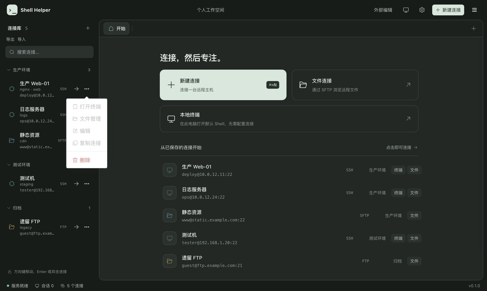

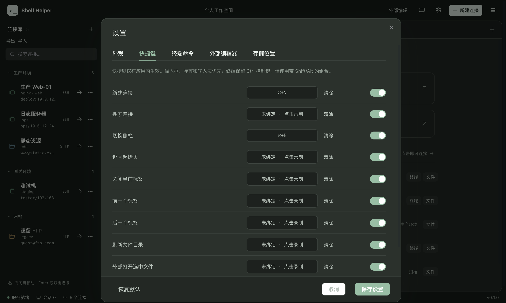

**根因**：

- [`main.scss`](../apps/desktop/src/renderer/src/styles/main.scss#L373-L440) 只覆盖了 Element Plus 的部分变量，`--el-bg-color-overlay`、`--el-border-color`、`--el-fill-color-blank`、`--el-color-white` 等仍是浅色默认值。下拉菜单、Select、Tooltip 的浮层使用 `--el-bg-color-overlay`，文字却跟随暗色变量，于是出现白底浅字。
- 暗色下 `--el-color-primary` 被改成浅绿 `#8fbfa3`，Element Plus 主按钮文字仍是白色，实测对比度约 **2.07:1**，低于 3:1。
- 协议色 `--sh-ssh / --sh-sftp / --sh-ftp / --sh-telnet / --sh-local` 没有暗色版本；在 `#222824` 背景上 SSH 约 **2.84:1**、Telnet 约 **3.24:1**、local 约 **3.29:1**。
- 文件类型图标颜色是硬编码浅色值，见 [`FileManager.vue`](../apps/desktop/src/renderer/src/components/FileManager.vue#L684-L689)，暗色下会变成一块块发亮的浅色方块。
- 全局滚动条滑块固定为深色半透明，暗色背景上几乎不可见，见 [`main.scss`](../apps/desktop/src/renderer/src/styles/main.scss#L183-L200)。
- 终端搜索条/右键菜单固定为深色，即使终端主题切到 `light` 也不跟随，见 [`TerminalView.vue`](../apps/desktop/src/renderer/src/components/TerminalView.vue#L368-L414)。

**建议**：

- 在 `html.theme-dark` 中补齐 Element Plus 变量：`--el-bg-color-overlay`、`--el-border-color`、`--el-border-color-light`、`--el-border-color-lighter`、`--el-fill-color-blank`、`--el-fill-color-light`、`--el-text-color-disabled`、`--el-box-shadow-light`；或直接引入 Element Plus 的 dark CSS vars 后做品牌色覆盖。
- 暗色主按钮显式设置深色文字：`--el-button-text-color: #1c2822`（对比度可到 7.38:1），或改用深色主色。
- 为五个协议色提供暗色 token，并在暗色下整体提亮。
- 把 `file-glyph` 的 `code/config/archive/image` 配色抽成 `--sh-file-*` 变量。
- 滚动条改成由主题变量控制。
- 终端搜索/右键菜单使用终端主题变量，或至少跟随 `settings.terminal.theme`。

### 1.2 960×600 下文件工具栏换行失控

**证据**：窗口宽度 960 时，`新建文件夹` 被单独挤到第二行，文件夹标题区域变成两行，文件列表只剩很窄的纵向空间。

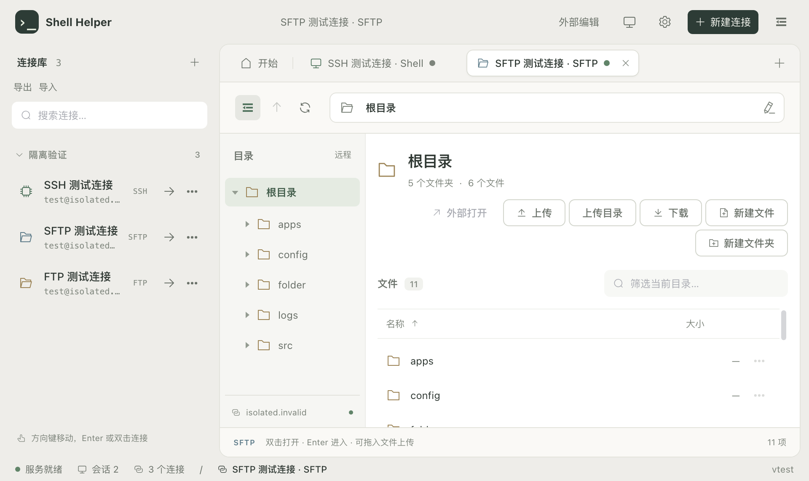

**根因**：[`FileManager.vue`](../apps/desktop/src/renderer/src/components/FileManager.vue#L528-L538) 在文件夹标题右侧最多平铺了 7 个操作（外部打开、上传、上传目录、下载、在此目录打开终端、新建文件、新建文件夹），`fm-actions` 只做了 `flex-wrap: wrap`，没有做断点降级。现有 Electron 测试只断言了“无横向溢出”，所以测试通过但视觉仍然崩。

**建议**：

- 把低频操作收进「更多」菜单：`在此目录打开终端`、`跟随终端`、`读取终端目录`。
- 「上传」用 split button：主按钮上传文件，下拉里是上传目录。
- 「新建」合并成下拉：新建文件 / 新建文件夹。
- 「外部打开」只在选中普通文件时出现，或移到文件行右键/双击语义里；不要作为标题旁的常驻文字按钮。
- 低于约 1000px 时按钮只保留图标 + tooltip，或整体折叠成一个操作菜单。
- 在测试中增加“文件夹标题高度不超过一行”/“操作按钮不孤立换行”的断言，而不只是 `scrollWidth <= clientWidth`。

### 1.3 命令面板被撑满整个窗口

**证据**：面板只有 7 条结果，却从顶部一直铺到底部，形成一个巨大的白色空板。

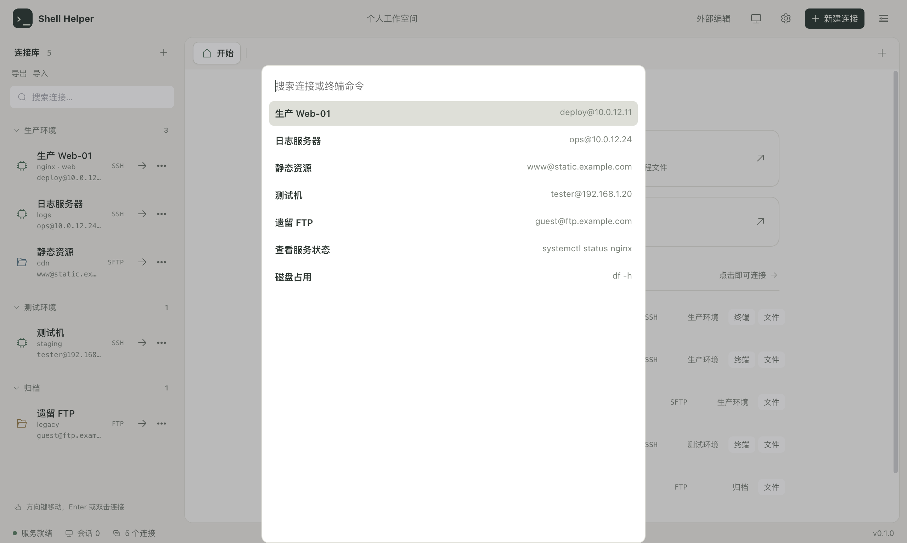

**根因**：[`CommandPalette.vue`](../apps/desktop/src/renderer/src/components/CommandPalette.vue#L70-L77) 的 `.palette-mask` 是 `display:flex`，默认 `align-items: stretch`；`.palette` 没有 `align-self`、没有 `max-height`，于是被纵向拉满。

**建议**：

```css
.palette {
  align-self: flex-start;
  max-height: min(62vh, 560px);
  overflow: auto;
  box-shadow: var(--sh-shadow-pop);
}
```

同时补上结果分组（“连接 / 终端命令”）、滚动时 active item 自动 `scrollIntoView`、`role="listbox"` / `aria-activedescendant`、关闭后焦点回到触发元素。

### 1.4 上传/拖拽在 Electron 33 下很可能已经失效

**证据**：[`FileManager.vue`](../apps/desktop/src/renderer/src/components/FileManager.vue#L297-L299) 仍然使用：

```ts
return (file as File & { path?: string }).path || ''
```

Electron 从 32 开始已移除非标准 `File.path`，官方给出的替代是 preload 中的 `webUtils.getPathForFile(file)`（[Electron Breaking Changes](https://www.electronjs.org/docs/latest/breaking-changes#removed-filepath)）。当前 [`preload/index.ts`](../apps/desktop/src/preload/index.ts) 没有暴露 `webUtils`，因此：

- 点击「上传」「上传目录」时，`localPath` 会为空，界面提示“无法读取本地文件路径”。
- 从系统拖文件进来同样拿不到本地路径。

这是功能问题，但直接毁掉文件页最核心的 UI 流程，建议和 UI 修复一起做：preload 暴露 `getPathForFile(file)`，或通过 `webUtils` + IPC 传递；补一条真实 Electron 上传测试。

### 1.5 主机行 hover 操作没有真正隐藏

**证据**：侧栏每一行都常驻“连接箭头 + 更多”两个按钮，加上协议标签，260px 宽度下地址被截断得很厉害。

**根因**：[`HostPanel.vue`](../apps/desktop/src/renderer/src/components/HostPanel.vue#L419-L423) 只写了 hover/focus/selected 时 `opacity: 1`，但 [`host-actions`](../apps/desktop/src/renderer/src/components/HostPanel.vue#L464-L468) 没有默认的 `opacity: 0`，所以一直是可见的。

**建议**：默认 `opacity: 0`，在 hover、`focus-within`、`.selected` 时显示；如果担心可发现性，可以让“连接”按钮常驻，把“更多”隐藏。

---

## 二、P1：布局、层级与状态表达

### 2.1 会话标题重复三遍，状态栏像开发调试栏

当前同一信息出现在三个位置：

- 顶栏的 `workspaceName`：`SFTP 测试连接 · SFTP`
- 标签页标题：`SFTP 测试连接 · SFTP`
- 底部状态栏的 `active-info`：`SFTP 测试连接 · SFTP`

同时状态栏还有 `服务就绪`、`会话 2`、`3 个连接`，以及一个没有标签的 `/`。`/` 其实是当前文件路径，但用户无法从上下文知道。

**建议**：

- 顶栏中间留给“工作区/面包屑”，不要重复标签标题；没有会话时显示“工作台”。
- 状态栏改成“连接 / 主机 / 路径 / 延迟”这类有标签、有单位的信息；隐藏 `v0.1.0` 或放到“关于”。
- `服务就绪` 换成 `已连接` / `离线`，或只在异常时显示。
- 删除 `active-info`，把会话信息留在标签栏。
- 给路径加前缀 `路径：/`，并做省略号截断，避免长标题把版本号挤出屏幕。

相关代码：[`App.vue`](../apps/desktop/src/renderer/src/App.vue#L282-L302)、[`App.vue`](../apps/desktop/src/renderer/src/App.vue#L434-L454)。

### 2.2 文件页操作平铺，缺少主次和批量感

1280px 下就已经有多达 7 个同级操作按钮；960px 下直接换行。更重要的是：

- 上传和下载都绑定 `:loading="transferring"`，下载时上传按钮也转圈。
- 传输进度只在 footer 的一行文字里，而且**只要选中了文件或有编辑状态，进度就会被覆盖**，见 [`FileManager.vue`](../apps/desktop/src/renderer/src/components/FileManager.vue#L599-L608)。
- 没有需求文档中的“传输队列/抽屉”，切到别的标签后就看不到任何传输状态。
- 多选、批量删除、批量下载在 UI 上没有汇总（没有“已选 3 项”操作条）；`picked` 只影响下载，用户很难发现。

**建议**：

- 动作分组：主操作「上传」+ 次操作「下载」+「新建」下拉 +「更多」。
- 传输状态优先于选中/编辑信息；增加全局传输指示（标签栏或状态栏），并提供可展开的传输列表：文件名、方向、进度、速度、剩余时间、取消。
- 选中多项时在列表上方浮出批量操作条（下载 / 删除 / 取消选择）。
- 上传目录与上传文件共用进度和取消语义。

### 2.3 侧栏主机交互模型不清晰

- 单击只“选中”，但选中状态没有对应的详情面板或操作区；双击/Enter 才连接。用户第一次使用时很容易以为单击就该连接。
- 没有右键菜单（需求文档明确要求主机右键菜单），只有“更多”下拉。
- 「导出 / 导入」是两枚 11px 裸文字，放在搜索框上方，既不像按钮，也没有菜单收纳。
- 底部常驻“方向键移动，Enter 或双击连接”，0 台主机时也显示。

**建议**：

- 明确一种主交互：单击选中 + 右侧/下方详情，或单击直接连接 + 更多菜单；不要停在“选中但无反馈”的中间态。
- 增加右键菜单：连接、终端、文件、编辑、复制、删除。
- 导出/导入收进“更多”或标题栏的 `…` 菜单，并补成功提示/导入预览。
- 空列表时隐藏键盘提示。

### 2.4 终端“正常退出”被当成“连接断开”

`exit` 后 WebSocket 以 1000 正常关闭，但 [`TerminalView.vue`](../apps/desktop/src/renderer/src/components/TerminalView.vue#L183-L190) 仍然把 `ended` 设为 true，随后底部横幅显示“连接已断开，输出仍保留在上方”，并给出“重新连接”；实际上用户只是主动结束了 Shell。

另外，PTY 启动失败时终端区是大片空白深色，只在底部有一条报错（见测试截图），没有居中的错误说明。

**建议**：

- 区分三种状态：`已结束（用户退出）`、`连接断开（异常）`、`启动失败（PTY/认证）`。
- 正常退出只显示“终端已结束”，保留输出，提供“关闭标签”/“重新打开”；不要出现误导性的“重新连接”。
- 失败时在终端中央显示错误卡片：原因、目标主机、重试、关闭；横幅只作为兜底。
- 标签状态点补文字或图标，不要只靠颜色。

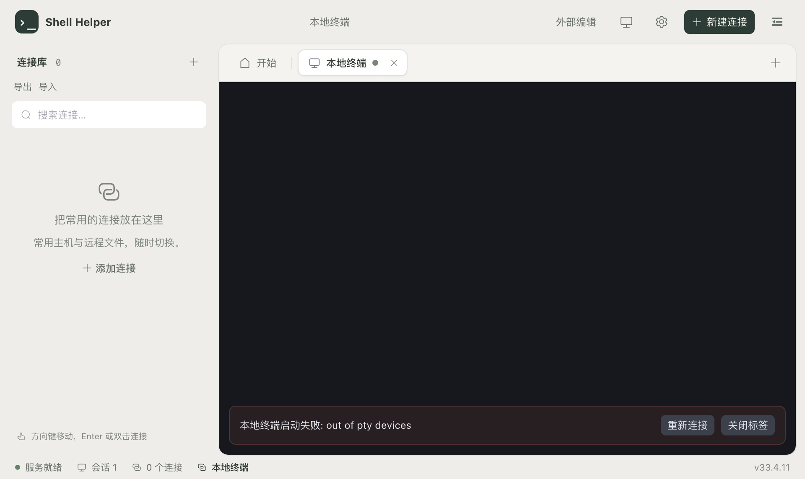

### 2.5 设置/表单的关键决策点被藏起来

- 设置在关闭/取消时没有“未保存修改”确认；改了一半点 X 直接丢失。
- 快捷键冲突、命令为空等校验错误显示在 tabs 下面的页面底部，用户看到“保存设置”是灰的，却看不到原因，见 [`SettingsDialog.vue`](../apps/desktop/src/renderer/src/components/SettingsDialog.vue#L156-L163)。
- 存储位置 tab 仍然显示“保存设置 / 恢复默认”，这两个动作和当前 tab 无关。
- 外观切换只是修改 draft，用户看不到实时预览。
- 新建连接表单在 960px 下必须滚动才能看到“测试连接 / 分组与高级设置”；高级设置入口在首屏之外，见 [`HostFormDialog.vue`](../apps/desktop/src/renderer/src/components/HostFormDialog.vue#L287-L312)。
- 删除主机确认只有名称，没有地址/协议；删除文件夹确认没有提示“包含子目录”。

**建议**：

- 设置改为“脏状态”模式：关闭前确认；校验错误就近展示（快捷键行内、命令卡片内）。
- 存储 tab 隐藏保存/恢复默认，或改为当前 tab 的局部操作。
- 外观/字号/主题在 draft 变化时即时预览，取消时恢复。
- 表单改为“基本信息 / 认证 / 高级”三段或 tabs；把分组移到基本区；补“保存并连接”。
- 删除确认补充 `username@host:port`；文件夹删除补充递归提示。

### 2.6 默认快捷键与需求不一致，命令面板不可发现

需求文档要求 `Cmd/Ctrl+T` 新会话、`Cmd/Ctrl+W` 关闭、`Cmd/Ctrl+F` 搜索、`Cmd/Ctrl+K` 命令面板；当前默认只绑定了 `Mod+N`（新建连接）、`Mod+B`、`Mod+,`。`Cmd+K` 是硬编码在 [`App.vue`](../apps/desktop/src/renderer/src/App.vue#L245-L252)，没有出现在设置里，也没有任何可见提示。

**建议**：

- 默认补齐 `Mod+T`、`Mod+W`、`Mod+F`、`Mod+K`，并处理与终端 Ctrl 控制键的冲突（终端内只拦截带 Shift/Alt 或 Cmd 的组合）。
- 把“命令面板”加入设置的动作列表，或至少在欢迎页/状态栏给出 `⌘K` 提示。
- 关闭标签、前/后标签、刷新文件等动作配置默认值，减少用户第一次进入设置时的空白感。

---

## 启动页重构（2026-10-29）

- 从「居中 Logo + 伪造三段进度条」改为左右分栏的启动检查面板：
  - 左侧保留品牌、启动标题和本地优先说明；
  - 右侧显示真实启动阶段、当前任务、错误态和完成进度。
- 启动阶段与 `initializeApp` 实际步骤绑定：读取设置 → 恢复草稿 → 启动本地服务 → 加载连接。
- 失败态沿用同一面板，展示真实错误、重试和日志入口，不再只显示一个泛化错误。
- 增加极轻的网格和蓝色径向光晕，保持 DSH 的克制感；960×600 和低高度窗口有紧凑布局。
- 最短展示时间从 650ms 提高到 **1600ms**，并增加 240ms 淡出，避免启动一瞬而过。
- 截图：[`51-startup-redesign-light.png`](ui-review/51-startup-redesign-light.png)、[`52-startup-redesign-960.png`](ui-review/52-startup-redesign-960.png)。

## 欢迎页重构（2026-10-29）

- 移除与顶栏重复的黑色 `›_` 图标块和强营销文案，改为轻量工作台标题「今天要连接哪里？」。
- composer 从页面底部移到首屏主视觉区，成为真正的入口；搜索建议改为向下展开。
- 首次无连接时显示「快速开始」三卡片：SSH 会话、文件连接、本地终端；有连接时显示「最近连接」列表。
- 内容和 composer 统一为 760px 阅读宽度，增加轻微顶部径向渐变，减少空页面的大面积留白。
- 960×600 下压缩间距，快速开始卡片保持可见；截图见 [`49-welcome-redesign-light.png`](ui-review/49-welcome-redesign-light.png)、[`50-welcome-redesign-960.png`](ui-review/50-welcome-redesign-960.png)。

## 三、P2：一致性、可访问性与细节

### 3.1 对比度与字号：辅助信息整体偏小偏浅

实测：

| 场景 | 前景 / 背景 | 对比度 | 判断 |
| --- | --- | --- | --- |
| 浅色辅助文字 | `#7b847a` / `#f4f3ef` | **3.49:1** | 9–11px 文本不达 WCAG AA 4.5:1 |
| 浅色侧栏辅助文字 | `#7b847a` / `#eeede8` | **3.30:1** | 同上 |
| 暗色 SSH 协议 | `#47755d` / `#222824` | **2.84:1** | 图标/标签偏低 |
| 暗色 SFTP 徽标 | `#577e8c` / `#222824` | **3.41:1** | 9px 文本偏低 |
| 暗色主按钮 | `#ffffff` / `#8fbfa3` | **2.07:1** | 不达 3:1 |

同时大量信息使用 9–11px：协议标签、地址、时间、状态栏、页脚提示、文件大小。中文在小字号下尤其吃力。

**建议**：

- `--sh-text-muted` 从 `#7b847a` 调到约 `#687168`（4.5:1 以上），并检查所有 10–11px 文本。
- 设定最小字号：辅助信息不低于 11px，正文/操作不低于 12px；状态栏 11px 可保留但提高对比度。
- 协议标签不要用 9px；至少 10–11px，并给暗色 token。
- 保持主色只用于主操作/选中态，不要让五个协议色都成为低对比文本色。

### 3.2 可访问性缺口

- 标签栏：`role="tablist"`/`role="tab"` 有了，但没有 `aria-controls`，对应内容区没有 `role="tabpanel"`。
- 工作台连接行是 `role="button"` 的 `div`，内部又嵌套 `button`，ARIA 结构不合法；且只处理 Enter，不处理 Space。
- 侧栏主机行使用 `role="group"`，不是列表/选项语义；方向键移动了选中态但没有 `aria-selected` 反馈。
- 文件表格的列头按钮没有 `aria-sort`；多选状态没有 `aria-selected`，只标记了主选中项。
- 状态点（已连接/连接中/已结束）是纯颜色 + `title`；色盲用户和键盘用户难以感知。
- 多个图标按钮只有 18–30px 点击区，低于桌面端建议的 32–36px；标签关闭按钮 18px 偏小。
- 命令面板没有焦点陷阱，Tab 会跑到背景应用；关闭后焦点落到 body。
- 全局 `user-select: none`，错误信息、远程路径、文件名称不能复制；文件页没有“复制路径”。

**建议**：优先修 Tab 面板语义、工作台按钮结构、状态点文字/图标、焦点管理；路径和错误信息允许选择，或补“复制路径”动作。

### 3.3 主题与启动一致性

- [`index.html`](../apps/desktop/src/renderer/index.html#L13-L21) 启动底色是深色 `#0f1117`，主进程窗口 `backgroundColor` 却是浅色 `#EEEDE8`，默认外观又是浅色；首屏会出现深/浅闪烁，暗色主题下窗口缩放也可能闪浅色。
- macOS 仍是系统原生标题栏 + 应用内 52px 顶栏，形成双层 chrome；`-webkit-app-region: drag` 在原生 frame 下收益有限。
- 暗色主题不改变原生标题栏/窗口背景，和页面主题脱节。

**建议**：启动底色跟随设置/系统外观；macOS 考虑 `titleBarStyle: 'hiddenInset'`，Windows/Linux 考虑 `titleBarOverlay` 或去掉应用内顶栏；至少让窗口 `backgroundColor` 与当前主题一致。

### 3.4 文件页与终端的次要比对问题

- 目录树刷新（`treeVersion++`）会重建树，非当前路径的展开状态全部丢失，见 [`FileManager.vue`](../apps/desktop/src/renderer/src/components/FileManager.vue#L171-L174)。
- 大目录仍是全量渲染 + `content-visibility`，没有虚拟列表；需求文档要求大目录流式/虚拟化。
- 文件页 `fmtTime` 固定 `zh-CN` 长格式，列宽 138px，暗色/窄屏下可读性一般。
- 终端搜索条覆盖终端右上角输出，没有匹配数量/大小写选项；右键菜单没有“全选”，也没有视口边缘钳制。
- 终端右键菜单“复制”在没有选区时仍然可点，点击后无反馈。
- 标签栏的左右滚动按钮用 `v-show`，出现/消失会造成标签位置横向跳动；侧栏拖宽时也不会触发 `updateOverflow`。

### 3.5 需求文档中尚未落地的界面

- 传输队列抽屉（6.2）
- 状态栏的延迟/服务器信息/编码（6.1）
- 本地/远程双栏文件管理（6.2）
- 首次启动引导（6.2）
- 关于页/更新提示（6.2）
- 主机与文件行的右键菜单（6.2 / 6.3）
- 默认 `Cmd+T / Cmd+W / Cmd+F / Cmd+K`（6.3）

这些不一定要一次做完，但建议在迭代计划里明确取舍。

---

## 四、建议的落地顺序

### 第 0 步：半天，先修“坏掉”的

- 暗色 Element Plus 变量 + 主按钮文字色 + 协议色。
- 命令面板 `align-self: flex-start` + `max-height`。
- 主机行 `host-actions` 默认隐藏。
- 960px 文件工具栏先做最小折叠：把“在此目录打开终端 / 上传目录 / 新建文件夹”收进“更多”。
- 修 `File.path` → `webUtils.getPathForFile`。
- 修 `--sh-text-muted` 对比度。

### 第 1 步：2–3 天，重构两个高频页面

- 文件页：操作分组 / 传输进度优先级 / 批量操作条 / 传输中心（可先做全局 toast + 简单抽屉）。
- 主机侧栏：右键菜单 / 单击行为统一 / 导出导入收纳 / 空状态隐藏提示。

### 第 2 步：1 周，补状态与可访问性

- 终端状态机（结束/断开/启动失败）与居中错误卡片。
- 标签/工作台/文件表格的 ARIA 与焦点管理。
- 设置脏状态、行内校验、实时预览。
- 暗色主题全量 token 化（文件图标、滚动条、终端搜索、阴影）。
- 960px 断点的视觉回归测试：不只测溢出，还要测换行、按钮孤立、标题高度、对比度。

---

## 五、验收清单

- [ ] 1280×820 与 960×600 下，文件页标题操作不出现“孤立换行”。
- [ ] 浅色/深色主题下，下拉菜单、Select、确认框、主按钮文字均可读；关键文本对比度 ≥ 4.5:1。
- [ ] 暗色下主机菜单、终端命令菜单、标签新建菜单没有白底浅字。
- [ ] 0 台主机 / 连接失败 / 终端退出 / 传输中 / 传输失败 五种状态都有明确视觉反馈。
- [ ] 上传文件、上传目录、系统拖拽三条路径在真实 Electron 中可用。
- [ ] `Cmd/Ctrl+K` 面板不铺满屏幕，结果有分组，方向键有可见 active 状态，Esc 关闭后焦点回原位。
- [ ] 键盘可以完成：打开连接、切换标签、关闭标签、搜索连接、刷新目录、打开文件。
- [ ] 侧栏、标签栏、文件表格在 960px 下无横向溢出，且主要操作仍在首屏。

---

## 附：本次截图

- [欢迎页浅色 1280](ui-review/01-welcome-light.png)
- [欢迎页暗色 1280](ui-review/02-welcome-dark.png)
- [命令面板](ui-review/03-command-palette.png)
- [文件页 960](ui-review/04-files-960.png)
- [文件页 1280](ui-review/05-files-1280.png)
- [暗色主机菜单](ui-review/06-dark-host-menu.png)
- [暗色设置](ui-review/07-dark-settings.png)
- [新建连接表单 960](ui-review/08-host-form-960.png)

---

## P0 实施记录（2026-10-28）

### 已完成

| 项 | 状态 | 主要变更 |
| --- | --- | --- |
| 暗色模式浮层/按钮 | ✅ | [`main.scss`](../apps/desktop/src/renderer/src/styles/main.scss) 补齐 `--el-bg-color-overlay`、边框、填充、禁用色、阴影；主按钮在暗色下改用深色文字；协议色与暗色终端/文件图标 token 化 |
| 960px 文件工具栏 | ✅ | [`FileManager.vue`](../apps/desktop/src/renderer/src/components/FileManager.vue) 在 ≤900px 容器下只显示图标，补 title/aria-label，上传目录传输中禁用 |
| 命令面板高度 | ✅ | [`CommandPalette.vue`](../apps/desktop/src/renderer/src/components/CommandPalette.vue) 增加 `align-self: flex-start`、`max-height`、内部滚动与阴影 |
| 主机行操作常显 | ✅ | [`HostPanel.vue`](../apps/desktop/src/renderer/src/components/HostPanel.vue) 默认 `opacity: 0` + `pointer-events: none`，hover/focus/selected 时显示 |
| 上传/拖拽路径 | ✅ | [`preload/index.ts`](../apps/desktop/src/preload/index.ts) 暴露 `webUtils.getPathForFile`；[`FileManager.vue`](../apps/desktop/src/renderer/src/components/FileManager.vue) 移除 `File.path` |
| 终端结束/断开 | ✅ | [`TerminalView.vue`](../apps/desktop/src/renderer/src/components/TerminalView.vue) 区分正常结束/异常断开/启动失败，新增居中错误卡片；light 终端下搜索条、右键菜单、错误态同步换色 |
| 类型检查前置错误 | ✅ | [`SettingsDialog.vue`](../apps/desktop/src/renderer/src/components/SettingsDialog.vue) 存储加载失败时补 `root: ''` |

### 验证

- `npm run typecheck`：通过。
- `npm test`：21/21 通过。
- Electron 交互回归：通过；新增断言覆盖命令面板高度、960px 文件操作同一行、`webUtils.getPathForFile` 真实路径、终端正常退出显示“终端已结束/重新打开”。
- `test:startup`：当前沙箱环境受 macOS PTY 资源限制，改动前后都停在同一句“首页打开真实本地终端”断言；该用例需在有可用 PTY 的桌面环境补跑。终端结束/断开逻辑已由模拟 WebSocket 回归覆盖。

### 修复后截图

- [暗色主机菜单](ui-review/11-after-dark-host-menu.png)
- [暗色设置页](ui-review/12-after-dark-settings.png)
- [暗色文件页](ui-review/14-after-dark-files.png)
- [960px 文件工具栏](ui-review/10-after-files-960.png)
- [命令面板](ui-review/13-after-command-palette.png)


---

## P1/P2 实施记录（2026-10-28）

### 启动界面（本轮新增）

- 新增 [`StartupScreen.vue`](../apps/desktop/src/renderer/src/components/StartupScreen.vue)，启动时覆盖全窗口显示品牌标识、当前步骤和说明；启动完成后自动移除。
- 启动步骤：读取设置 → 恢复编辑草稿 → 启动本地服务 → 加载连接；最少展示 650ms，避免一闪而过。
- 失败时显示错误卡片、清理后的错误信息、「重新启动」和「打开日志目录」；`z-index` 高于 Element Plus 的 loading mask，避免侧栏加载动画穿透。
- 启动界面在 [`App.vue`](../apps/desktop/src/renderer/src/App.vue) 的 `initializeApp()` 中驱动，保存标签恢复移到启动完成之后。

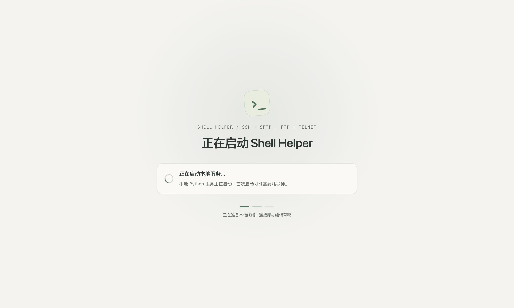

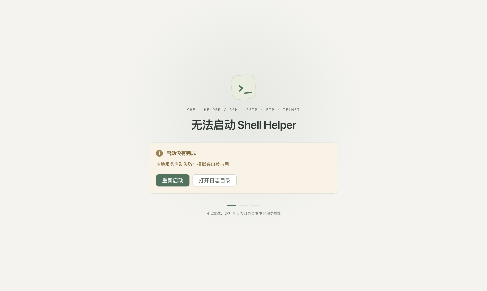

### 其他已完成

| 项 | 状态 | 主要变更 |
| --- | --- | --- |
| 全局传输中心 | ✅（本轮续补） | 跨标签聚合任务，顶栏计数、进行中/最近、速度/ETA、取消 |
| 连接表单分段导航 | ✅（本轮续补） | 基本信息 / 身份认证 / 分组与高级 sticky 导航，960px 可直达 |
| 状态栏与信息层级 | ✅ | 首页/起始页统一为「工作台」；状态栏改为「已就绪 / 标签 / 连接 / 路径」并去掉重复的活动标签标题；路径可省略展示 |
| 文件页批量操作 | ✅ | 选中多项时显示「已选 N 项」批量条，支持下载、删除、取消选择；补充 `aria-selected` 与列头 `aria-sort` |
| 传输抽屉 | ✅（文件页内） | footer 传输进度优先于选中/编辑状态；新增传输抽屉，显示当前任务、百分比、已传/总量、取消和最近 8 条记录；上传设为 Primary |
| 目录树刷新 | ✅ | 记住展开路径，刷新后重新展开，不再丢失浏览位置 |
| 设置脏状态 | ✅ | 关闭/取消前确认未保存修改；校验错误移到 footer 可见位置；存储位置 tab 隐藏无关的「保存设置/恢复默认」 |
| 编辑器设置 | ✅ | 仅在选择「自定义编辑器」时显示路径与选择按钮 |
| 默认快捷键 | ✅ | 补齐 `Mod+F` 搜索、`Mod+W` 关闭、`Mod+Shift+H` 返回工作台、`Mod+Alt+←/→` 前后标签、`Mod+Shift+R` 刷新目录等；`Mod+F` 在终端内让位给终端搜索 |
| 命令面板 | ✅（继续完善） | 结果按「连接 / 终端命令」分组；listbox/option、`aria-activedescendant`、Tab 焦点陷阱、active 自动滚动、关闭后焦点回原处 |
| 主机右键菜单 | ✅ | 主机行右键弹出终端/文件/编辑/复制/删除菜单；操作按钮改为 hover 覆盖层，不再挤压主机名 |
| 对比度与字号 | ✅ | 浅色辅助文字提升到 4.5:1 以上；协议色在浅色下加深；多处 9–10px 文案提升到 10–11px |
| 启动底色 | ✅ | Electron 窗口底色跟随保存的外观；`index.html` 默认底色与浅色外壳一致，减少启动深浅错位 |
| 标签可访问性 | ✅ | 标签增加 `aria-controls`，内容区增加 `tabpanel` 与 `aria-labelledby`；工作台连接行补 Space 键支持 |

### 修复后界面

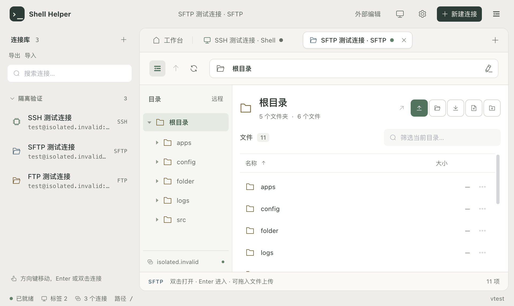

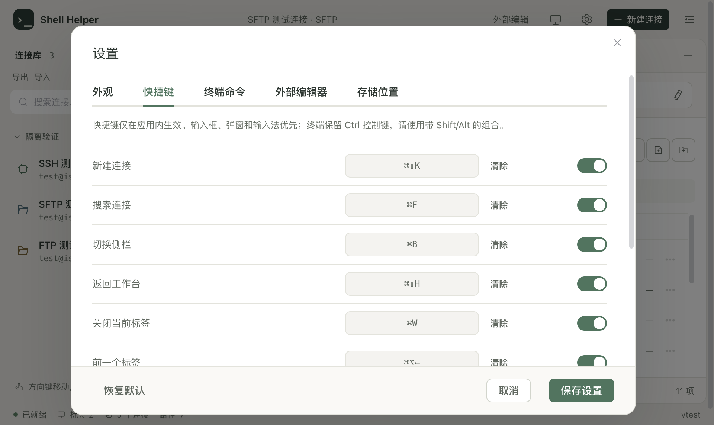

### 高级功能第一阶段：本地/远程双栏（2026-10-29）

- 文件页工具栏新增「本地/远程双栏」入口；打开后隐藏左侧导航卡，左侧显示本地目录、右侧保留远程文件页。
- 本地栏可选择目录、进入子目录、刷新和上一级；按当前远程目录实时显示「仅本地 / 不同 / 同名」标记，并统计仅远程项。
- 支持把选中本地文件上传到当前远程目录、上传仅本地文件、下载仅远程文件到当前本地目录；复用全局传输中心、进度和取消。
- 当前实现是双栏 + 单向差异同步的 MVP：普通文件支持；目录同步、覆盖策略、冲突预览和双向镜像留到后续迭代。
- 新增 `files:list-local-dir` 主进程接口，本地列表只读，不上传远端。

### 局域网用户头像与辨识（2026-10-29）

- 局域网资料新增可选头像：点击自己头像选择图片，自动裁切为 64×64 WebP，限制 3.2KB 内并以 data URL 随发现广播。
- 未设置头像时使用「稳定颜色 + 姓名首字」的默认头像；颜色由用户 ID 哈希生成，同一用户在不同机器上保持一致。
- 在线用户列表同时显示头像、显示名、设备名和局域网地址，避免同名用户无法区分。
- 头像只保存在本机资料文件，不经过后端；局域网内可见，建议不要使用包含敏感信息的照片。
- 受 UDP 发现包大小限制，头像仅支持压缩后的小图；不支持相册、头像历史或跨设备同步。

### 高级功能：1:1 局域网远程协助（2026-10-29）

- 局域网面板的在线用户增加「屏幕」入口：发起屏幕共享邀请，对方在弹窗中接受/拒绝。
- 接受后通过 WebRTC 建立点对点连接：
  - 共享方采集主屏幕；
  - 可选麦克风；
  - 查看方以只读视频窗口查看；
  - 内置文字聊天（WebRTC DataChannel，断线时回退到局域网信令）。
- 信令复用局域网 UDP：SDP/ICE 分片、重组后交给渲染层；不经过后端、不上传公网。
- Electron 主进程注册 `getDisplayMedia` 处理器，只提供主屏幕；macOS 增加屏幕录制/麦克风用途说明。
- 视频/音频由 WebRTC 加密传输；信令为局域网明文，依赖邀请确认，不提供房间口令或身份验证。
- 当前为「演示/查看」MVP：不支持远程控制、窗口选择、系统声音、TURN、跨网段或 5 人以上会议。

### 高级功能第六阶段：工作区 / 项目一键启动（2026-10-29）

- 顶栏新增「工作区」入口；工作区保存在本机 `localStorage`，不包含密码、密钥。
- 支持两种创建方式：
  - 选择主机、可选本地项目目录和终端启动命令；
  - 一键把当前所有主机标签保存为工作区。
- 打开工作区会按保存的类型恢复终端/文件标签，并为终端带上启动命令；本地目录会写回本地双栏的路径偏好。
- 支持删除工作区；主机被删除后会显示并跳过。
- 当前限制：不恢复分屏布局、终端录制、窗口尺寸，也不跨设备同步；启动命令以明文保存在本机浏览器存储。

### 高级功能第五阶段：局域网共享终端（只读，2026-10-29）

- 终端右上角增加「共享」按钮；开启后把当前终端标题/主机信息广播给同一局域网内已启用发现的用户。
- 局域网面板新增「共享终端」区：在线用户能看到共享、加入只读查看、离开；共享者可随时停止。
- 查看端使用独立 xterm 只读窗口，接收增量输出和 ANSI 颜色；共享者关闭/停止后自动结束。
- 输出按 700 字符 base64 分片经 UDP 组播传输；不经过后端、不建立公网连接。
- 当前为只读 MVP：不支持对方输入、回放、鉴权、加密或丢包重传；UDP 在极端网络下可能乱序/丢包，且终端内容可能含敏感信息。

### 高级功能第四阶段：终端分屏 / 广播 / 录制（2026-10-29）

- 顶栏在有多个终端标签时提供分屏按钮；左侧保留当前终端，右侧可选择另一个终端，按 1:1 排列。
- 分屏条提供「广播输入」开关；开启后一个终端的键盘输入会同步到所有已打开终端，退出分屏时自动关闭广播。
- 终端右上角增加搜索和 REC 控件；REC 捕获当前终端输出，停止时通过系统保存对话框导出 `.txt` 文件（保留原始 ANSI 输出）。
- 录制上限 30 MiB；录制只在本机内存中，不上传、不写后端；切换/关闭终端时停止当前录制。

### 高级功能第三阶段：SSH 本地端口转发（2026-10-29）

- 主机右键新增「端口转发」，打开规则管理弹窗；规则持久化到 SQLite，按主机查询。
- 支持 `127.0.0.1:<本地端口> → <远端主机>:<远端端口>` 的本地转发；本地端口可填 0 自动分配。
- 每条规则独立建立 SSH 连接（支持已有跳板链），启动/停止、复制本地地址、删除规则。
- 运行状态、自动分配端口和错误信息在列表中展示；应用关闭/后端 shutdown 会停止所有转发。
- 当前为本地转发 MVP：暂不支持远程转发、SOCKS5、开机自动启动和断线自动重连。

### 高级功能第二阶段：可恢复下载（2026-10-29）

- 大文件下载失败/取消后，从本地已写入的大小继续请求；后端 `/api/files/download` 支持 `Range`，SFTP 使用 seek、FTP 使用 `REST`，返回 `206` / `Content-Range`。
- 主进程下载支持 `resume`，按已有文件大小追加；服务器不支持 Range 时安全回退为完整重下。
- 全局传输中心的失败下载记录提供「续传」按钮，复用原保存路径继续；并行任务仍由全局队列聚合。
- 当前为下载方向的可恢复 MVP；上传断点续传、主动暂停/恢复、校验和与真正并发分片留到后续迭代。

### P1 续补（2026-10-29）

- **全局传输中心**：新增 [`transfers.ts`](../apps/desktop/src/renderer/src/stores/transfers.ts) 聚合跨标签任务；顶栏传输图标显示进行中数量，抽屉展示进行中/最近任务、进度、平均速度和预计剩余时间，支持取消与清空记录。文件页原有工具栏和任务抽屉保留。
- **连接表单分段导航**：新建/编辑连接增加 sticky「基本信息 / 身份认证 / 分组与高级」导航；960px 下可直接跳到认证和高级设置，不必从头滚动。

### P2 续补（2026-10-29）

- **终端搜索**：增加匹配数量 `当前/总数`、区分大小写 `Aa`、输入即搜索；高亮当前匹配。
- **终端右键菜单**：增加「全选」，无选区时「复制」置灰；菜单按终端视口边缘钳制，不再溢出。
- **文件行右键菜单**：打开 / 下载 / 重命名 / 复制路径 / 删除；复制路径复用系统剪贴板。
- **标签溢出**：左右滚动按钮改为保留占位、隐藏时不再挤压标签；增加 `ResizeObserver`，侧栏拖宽后立即重算溢出边界。

### 仍然保留（未在本轮完成）

- 文件列表虚拟滚动（大目录）、本地/远程双栏、首次启动引导、关于页。
- macOS 原生标题栏 + 应用内顶栏的双层 chrome；彻底处理需要改窗口 `titleBarStyle` 并重排顶栏。
- 设置高级区（分组/跳板机/初始目录）在 960px 下仍需要滚动；建议下一轮改成「基本/认证/高级」tabs。

### 验证

- `npm run typecheck`：通过。
- `npm test`：21/21 通过（新增默认快捷键、`displayShortcut`、终端 Cmd/Ctrl+F 让位断言）。
- Electron 交互回归：通过；新增主机右键菜单、批量选择条、命令面板、设置打开/保存/关闭流程。
- 启动界面使用隔离 IPC 模拟慢启动、启动失败两条路径截图验证。
- `test:startup` 仍受当前沙箱 PTY 资源限制，需在有可用 PTY 的桌面环境补跑。


---

## 外部编辑实时同步（2026-10-28 追加）

### 行为

- 后端新增轻量元数据接口 `GET /api/files/stat`，返回远程文件的 `size / mtime / mode`，不下载文件正文。
- 外部编辑服务默认每 **3 秒**检查一次已打开草稿对应的远程文件。
- 远程内容变化时：
  - 本地副本没有未回传修改：下载新内容并原子替换本地副本，状态回到「已同步」，编辑器可检测到文件更新。
  - 本地有未回传修改：**不覆盖本地文件**，更新远程基准摘要并标记「远程冲突」，保留本地内容。
- 冲突解决：
  - 新增 `edits:reload` IPC 与「用远程版本覆盖本地」操作，确认后下载远程版本、重置草稿状态。
  - 顶栏/外部编辑弹窗出现冲突提示，避免用户只看到旧状态。
  - 自动同步和冲突都会在渲染层给出提示。
- 旧版后端没有 `/stat` 路由时不会把 404 误判为“远程文件被删除”。

### 变更

- 后端：[`file_provider.py`](../backend/app/services/file_provider.py)、[`files.py`](../backend/app/api/files.py)
- 主进程：[`external-edit.ts`](../apps/desktop/src/main/external-edit.ts)、[`index.ts`](../apps/desktop/src/main/index.ts)
- 渲染层：[`external.ts`](../apps/desktop/src/renderer/src/stores/external.ts)、[`ExternalEdits.vue`](../apps/desktop/src/renderer/src/components/ExternalEdits.vue)、[`preload/index.ts`](../apps/desktop/src/preload/index.ts)
- 测试：[`features.test.cjs`](../apps/desktop/tests/features.test.cjs) 新增自动同步/冲突/覆盖本地用例；[`test_file_content.py`](../backend/tests/test_file_content.py) 新增 `/stat` 回归。

### 验证

- `npm run typecheck`：通过。
- `npm test`：21/21 通过。
- 后端 `test_file_content`：18/18 通过。
- Electron 交互回归：通过。
- 注意：打包产物的 Python 后端需要重新执行 `scripts/package.sh` / `scripts/package.ps1` 才会带上 `/api/files/stat`。


---

## DSH 风格视觉重构（2026-10-28）

参考 DeepSeek Harness 的界面语言，对 Shell Helper 做了一轮整体视觉重构，而不是逐像素复刻；终端、文件、外部编辑等业务交互保持不变。

### 采纳的设计语言

- **中性蓝白表面**：页面 `#f9fafb`、侧栏 `#f5f6f7`、主内容 `#ffffff`，替换原先的暖米色 / 绿色体系。
- **黑色字标 + 蓝色强调**：品牌字标改为 Montserrat 大写、黑色 logo；交互强调统一为 DeepSeek 蓝 `#3468d8`（暗色 `#5686fe`）。黑色用于品牌、主 CTA、欢迎页主卡片。
- **DSH 圆角与描边**：输入 / 按钮 8px、卡片 12–16px、弹窗 20px；边框使用 8%–18% 透明度的细描边，浮层使用 `0 0 0 .5px` 描边 + 轻微扩散阴影。
- **下划线标签**：工作区标签从白底 pill 改为文字 + 蓝色下划线，移除选中标签的卡片阴影。
- **侧栏引导**：侧栏顶部加入全宽「新建连接」按钮；连接库标题右侧收纳导出/导入图标，减少裸文字操作。
- **主内容顶部标题/状态栏**：会话区上方显示当前工作区标题、主机地址，以及协议、连接状态、路径/终端尺寸 chips；主内容与标签栏形成 DSH 式层级。
- **聊天式 composer**：欢迎页底部加入 composer，可搜索已保存连接并回车连接；没有匹配时把输入带进新建连接表单。composer 内置新建连接、文件、本地终端入口和蓝色发送按钮。
- **Montserrat**：内置 OFL 字体的 300/400/500 三个字重，英文、数字、字标使用 Montserrat，中文回退 PingFang / 微软雅黑。
- **macOS 原生融合**：macOS 使用 `titleBarStyle: 'hiddenInset'`，把红绿灯交给窗口，应用顶栏为红绿灯留出 86px；Windows/Linux 仍保留原生标题栏。
- **暗色主题**同步切换为 DSH 式中性深色：`#151517 / #1b1b1c / #232324`、白色字标、蓝色强调。

### 覆盖范围

- 顶栏、侧栏、欢迎页、标签栏、状态栏
- 文件管理器工具栏、目录树、文件表格、批量条、传输抽屉
- 设置、连接表单、命令面板、外部编辑、启动界面
- 终端默认深色 / 浅色主题、终端搜索条与错误态
- Element Plus 主色、圆角、输入焦点、弹窗、开关与标签

### Composer 与主区标题栏

- Composer 固定在欢迎页底部，上方显示匹配连接；支持方向键选择、Enter 连接、Esc 关闭建议。
- 主内容顶部标题栏在欢迎页显示「工作台」、连接库数量、本地服务状态；在会话中显示当前标题、主机地址、协议、连接状态和路径/终端尺寸。
- 状态栏底部只保留应用级信息，避免和主区状态栏重复。

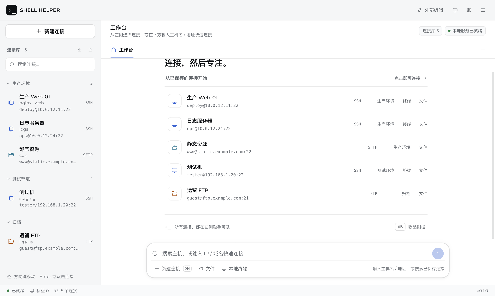

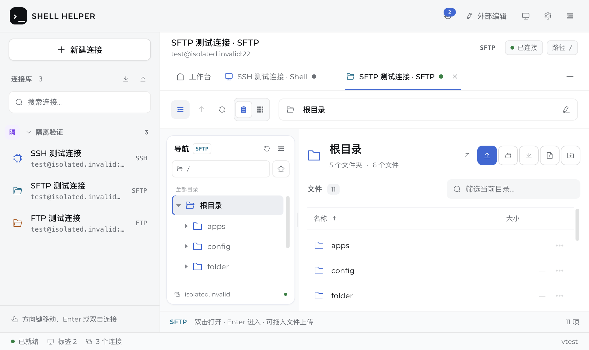

### SFTP / FTP 导航卡

- 目录树从贴着工具栏和状态栏的灰色 rail，改为独立浮动的「导航」卡：白底、12px 圆角、细描边和页面留白，文件内容区获得独立表面。
- 卡片内按「路径 → 收藏 → 全部目录」组织：当前路径可直接定位，右侧星标收藏当前目录，收藏按主机持久化；收藏为空时自动收起该分组。
- 头部保留协议 chip、刷新、收起其他分支；树节点使用 32px 紧凑行、展开文件夹图标和当前节点蓝色定位条。
- 导航卡支持鼠标拖拽调整宽度（170–360px），双击复位，方向键也可调整；宽度写入本地设置。
- 加载 / 断线 / 加载失败有独立状态与重试入口；FTP 与 SFTP 的协议色分别使用 amber / cyan。
- 960×600 下默认导航卡宽 210px，仍保留文件表格的可读宽度。


### Miller columns 分栏视图

- 文件页增加「列表 / 分栏」视图切换，选择写入本地设置，重新打开文件页仍沿用上次模式。
- 分栏视图按当前路径展开祖先目录列，点击文件夹追加下一列；当前路径链在祖先列中以蓝色选中，当前列标题使用蓝色下划线。
- 每列显示目录名、条目数、文件夹 / 文件图标；文件单击选中，双击外部打开，Enter 可打开选中项。
- 分栏视图隐藏左侧导航卡，把横向空间让给列；窗口变窄时自动滚动到当前列，保留横向滚动。
- 目录加载中、连接断开、列加载失败有独立状态与重试；列表视图继续保留目录收藏、拖拽宽度等能力。

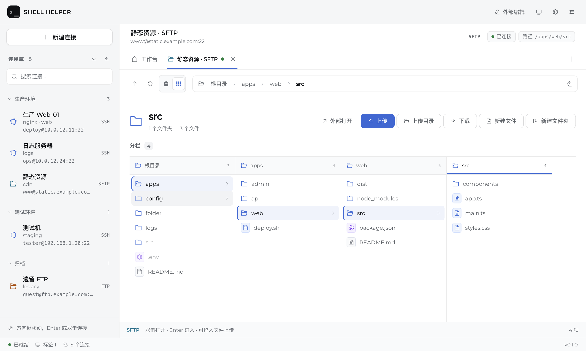

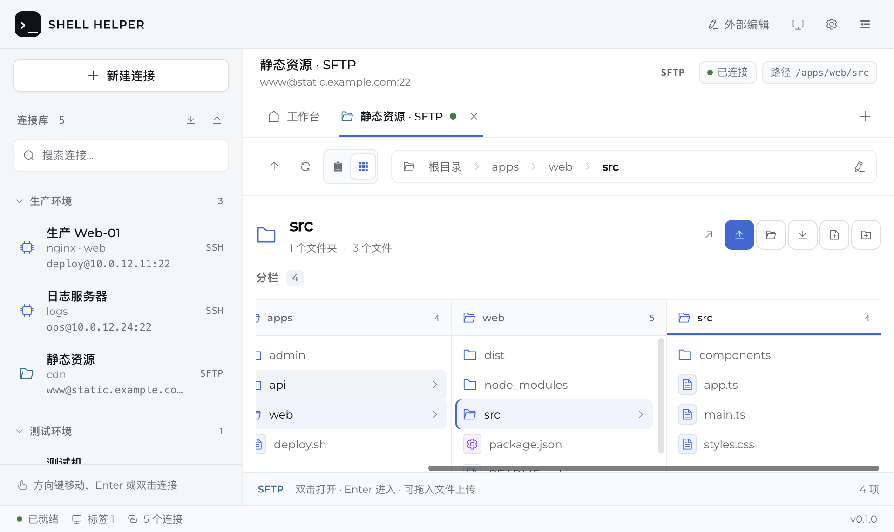

### 新建连接入口收敛

- 正常界面只保留侧栏顶部一个「新建连接」主入口，并在按钮内展示当前快捷键。
- 移除顶栏标签栏的「+ / 新建连接」下拉入口、欢迎页 composer 的「新建连接」按钮，以及主机空状态里的重复「添加连接」按钮。
- 保留全局 `⌘N` / `Ctrl+N`、composer 输入主机地址回车新建，以及侧栏隐藏时顶栏出现的条件性 `+` 入口。
- 空状态文案改为引导使用侧栏主入口，不再重复放按钮。

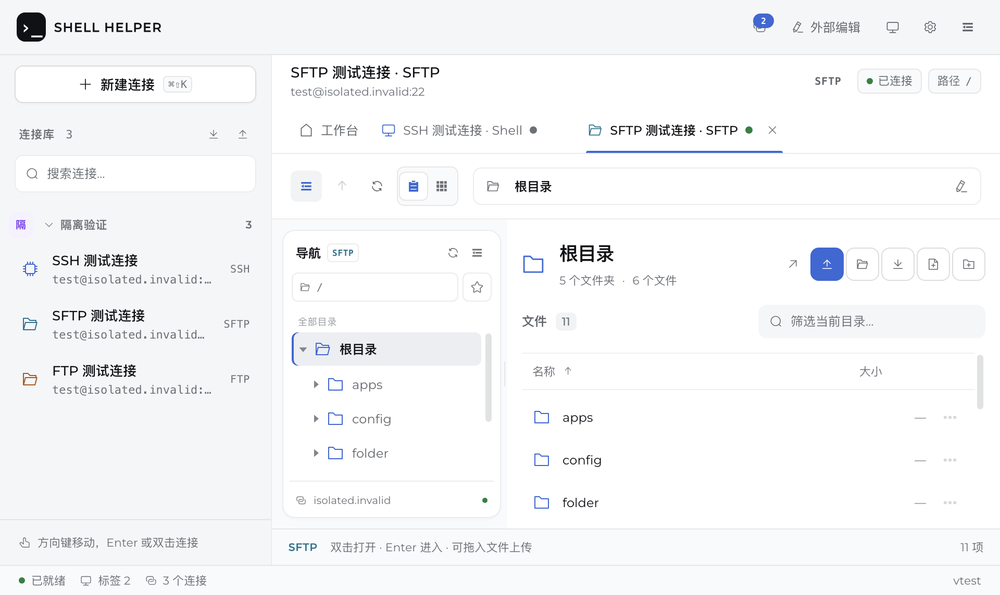

### 大文件下载完成通知

- 下载成功且实际写入达到 **100 MiB** 时，主进程通过 Electron `Notification` 发系统通知，避免小文件频繁打扰。
- 通知标题「大文件下载完成」，正文包含文件名、实际大小和保存目录；点击通知在系统文件管理器中定位文件。
- Windows 设置 AppUserModelID；macOS/Linux 使用系统通知中心，首次使用需要允许 Shell Helper 通知权限。
- 下载失败或取消不通知；通知只在文件完全关闭后触发。

### 分组头像

- 连接分组标题左侧增加 24px 头像：未设置时使用分组名首字的文字头像，并按组名稳定映射 5 种 DSH 色调；设置后显示图片。
- 点击分组头像打开菜单：上传分组头像、移除头像；支持 PNG / JPEG / WebP / GIF，限制 512 KiB。
- 头像以 data URL 保存在本地 `localStorage`，不上传、不进入连接配置分享；分组名变化时需要重新设置。
- 960px 侧栏仍保持头像、分组名、数量和折叠箭头的单行布局。


### 局域网发现与协作

- Electron 主进程使用 UDP multicast `239.255.42.99:47823` 每 3 秒广播在线状态，10 秒无心跳视为离线；不经过 Python 后端，打包后同样可用。发现默认开启，可在面板关闭。
- 顶栏新增局域网入口，显示在线人数和未读提示；面板包含显示名、设备名、在线开关、在线用户、文件/分享动态和已读操作。
- 连接右键「分享到局域网」或面板底部「分享连接给在线用户」会打开分享弹窗；发送内容只包含名称、协议、主机、端口、用户名、分组、标签和远端目录，不包含密码、密钥、凭据 ID 或跳板配置。
- 接收方看到分享动态后可「导入连接」；导入为密码认证但密码为空，界面提示用户编辑并补充凭据。
- 文件新建、上传回传、重命名、删除会广播文件变更；在线用户收到 toast 与动态记录。
- 隐私边界：局域网消息不加密、不鉴权，仅在可信局域网使用；需要同一网段并允许应用访问本地网络/防火墙。文件变更事件来自应用内的新建、上传、重命名和删除操作，不监听系统级文件改动。
- 扫描/发现采用尽力而为的 UDP，不做离线消息重放；事件保留在当前进程内。

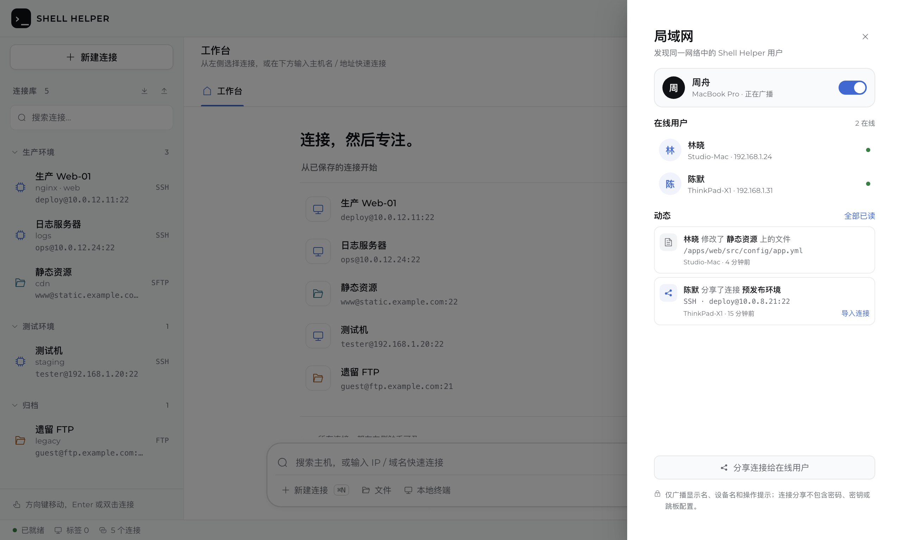

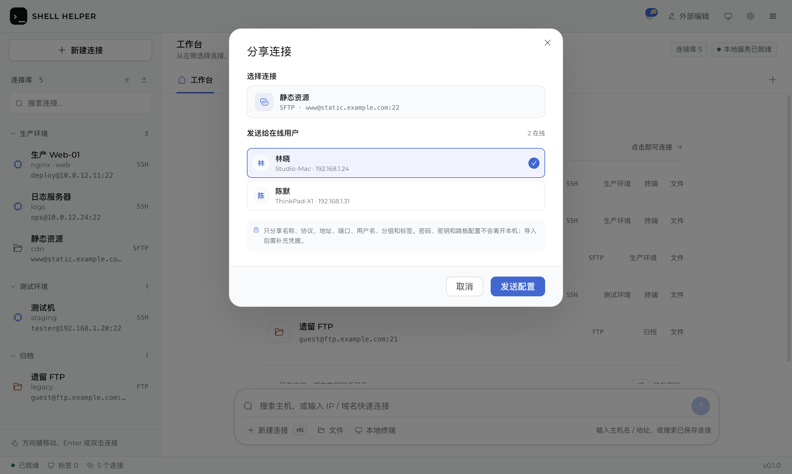

### 外观设置打磨

- 主题选择改为三张带 mini preview（浅色 / 深色 / 跟随系统）的卡片，选中态使用蓝色描边 + 勾选标记。
- 外观切换实时预览：点选后应用外壳立即切换，保存后生效，取消 / 关闭会恢复到原设置。
- 终端外观改为左侧实时终端预览 + 右侧字号、字体、配色、选中即复制；配色改为五个带色块的 chip，而不是下拉框。
- 960×600 下外观页保持滚动，不会挤压保存 / 取消底栏。

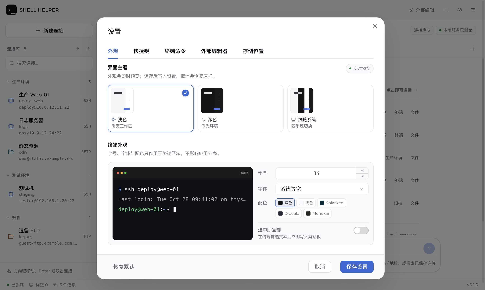

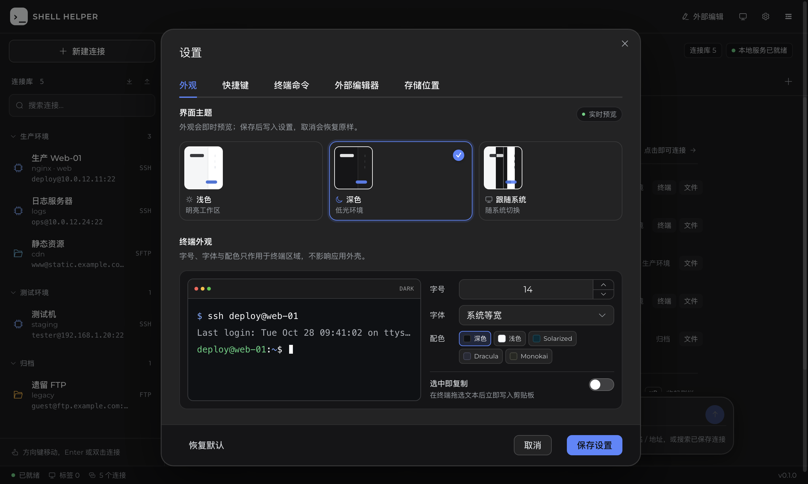

### 设置页统一

设置弹窗的另外四个页面补齐了与「外观」一致的 section / card 结构：

- **快捷键**：section 标题 + 搜索 + 数量 chip + 卡片化行；每行增加动作说明，录制器、清除、开关保持一列对齐。
- **终端命令**：命令库标题 + 数量 + 添加入口；单条命令拆成「序号 / 名称 / 命令输入 / 快捷键」卡片，删除改为图标按钮，并补空状态。
- **外部编辑器**：打开方式改为两张选择卡片（系统默认 / 指定编辑器），保留自定义路径表单、安全说明和临时文件入口。
- **存储位置**：标题与刷新、应用数据目录卡片、四个位置卡片、复制/打开操作统一为同一套卡片和按钮层级。
- 所有页面切 tab 时自动回到顶部；960×600 下保留滚动区和固定底部操作栏。

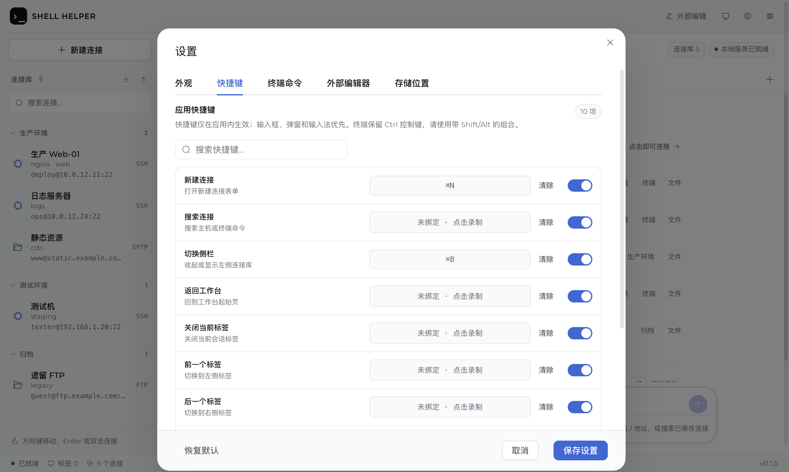

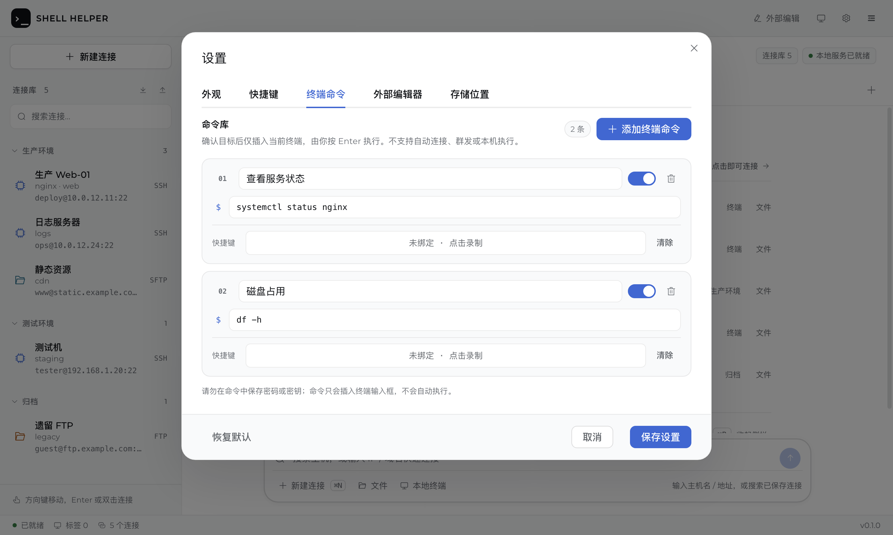

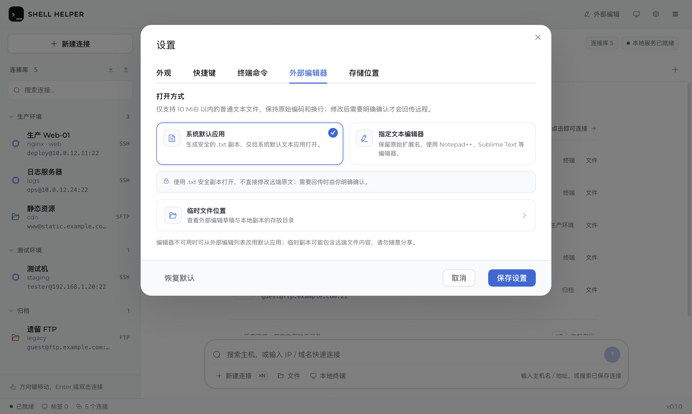

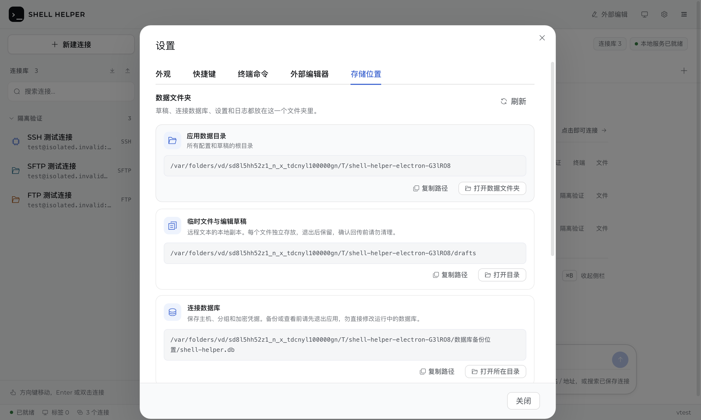

### 设计参考截图


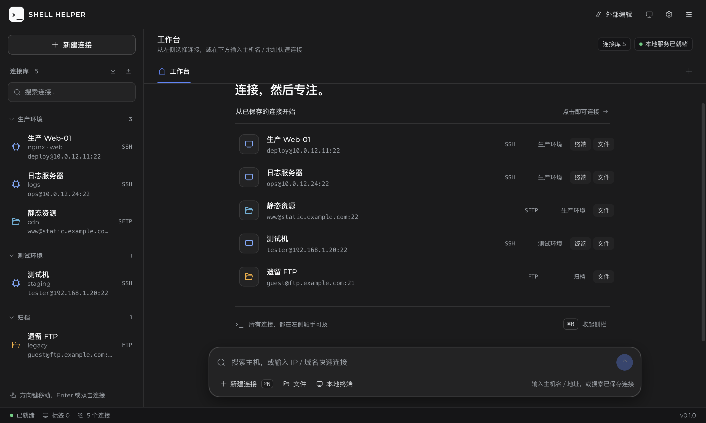


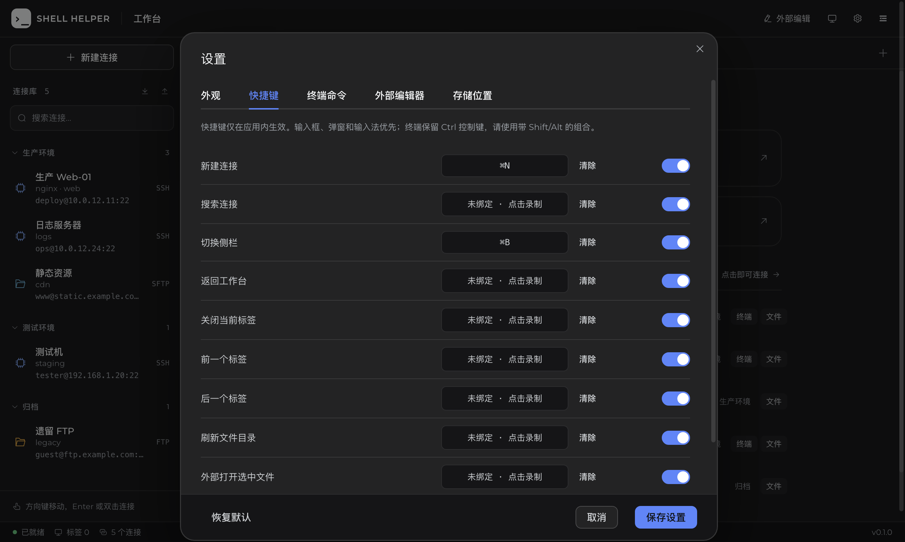

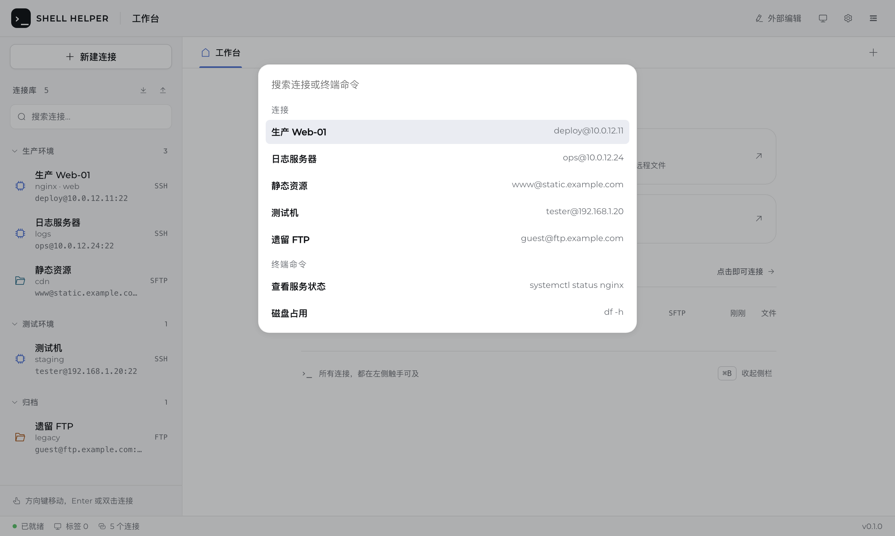

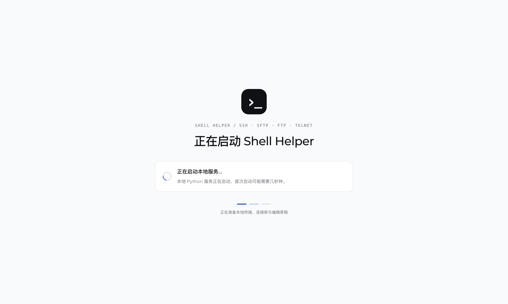

> 截图来自 Electron `capturePage()`，只包含 Web 内容；macOS 原生红绿灯不在 Web 截图内，实际窗口中它们位于顶栏左侧 86px 留白处。
